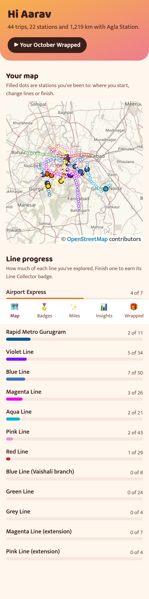
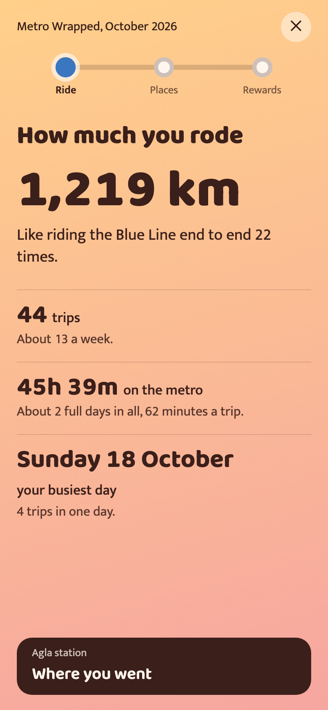
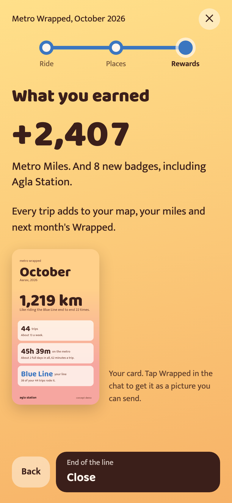
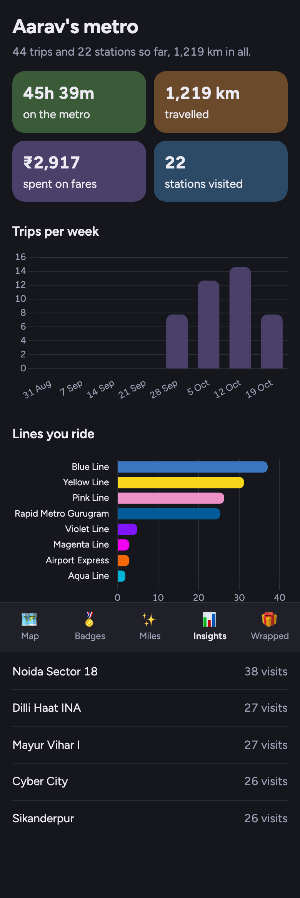

# Agla Station 🚇

A Telegram bot for the whole Delhi NCR metro network (DMRC lines, Airport Express, Rapid Metro Gurugram and the Noida Aqua Line). The name comes from the train announcement *"agla station…"*. Ride more, ride safer, have fun doing it.

Text it where you're going, the way you'd say it: *"rajiv chowk to hauz khas"*, *"RC se botanical garden, sasta wala"*, *"cyber hub to noida sec 18"*.

- **Routes and official fares** across all four operators: fastest, fewest changes or cheapest, with Sunday and holiday pricing.
- **UPI payment link and QR** that opens GPay, PhonePe or Paytm, then a **demo QR ticket**.
- **📤 Share journey:** a live link showing where you should be, from the timetable. **✅ I've reached:** a ready-made message you send to whoever's waiting.
- **Metro Miles, badges and rewards**, a **dashboard Mini App** with your map, badges, miles and insights, and a monthly **Metro Wrapped**: a three-stop ride through your month (how much, where, what you earned) and a card to share.
- Replies in **English, Hinglish or हिंदी**. Menu buttons instead of slash commands.

| Dashboard | Metro Wrapped: ride | Metro Wrapped: rewards | Insights (dark) |
| --- | --- | --- | --- |
|  |  |  |  |

## Honest constraints

- Tickets are mock QR tickets. DMRC has no public ticket-issuing API.
- Payment is a UPI intent link; payment is not verified.
- Fares come from official sources and were spot-checked by hand; never invented.
- Journey sharing is an estimate from the timetable, not live GPS (there's no signal underground). The share page says so.
- Metro Miles and rewards are a concept demo. Vouchers say "DEMO — concept only, not redeemable".

## Run it

You need Python 3.12, [uv](https://docs.astral.sh/uv/), an Anthropic API key and a Telegram bot token from [@BotFather](https://t.me/BotFather). For public share links and the Mini App you also need `cloudflared` (`brew install cloudflared`).

```bash
uv sync
cp .env.example .env          # fill in the keys; DASHBOARD_SECRET: python3 -c "import secrets; print(secrets.token_urlsafe(32))"
uv run python -m scripts.seed_demo   # optional: a demo rider with a month of trips
uv run python -m agla --tunnel       # bot + web app + a public https tunnel, in one process
```

Open your bot in Telegram and send `/start`. Ctrl-C stops the bot, the web server and the tunnel together.

| `.env` key | Used for |
| --- | --- |
| `ANTHROPIC_API_KEY` | Claude (`claude-sonnet-5-5`) |
| `TELEGRAM_BOT_TOKEN`, `TELEGRAM_BOT_USERNAME` | The bot |
| `UPI_VPA`, `UPI_PAYEE_NAME` | Payment links |
| `PUBLIC_BASE_URL` | Only if you host it yourself; `--tunnel` sets the URL automatically |
| `DASHBOARD_SECRET` | Signing the dashboard's browser links |

## How it works

**Code decides, the LLM narrates.** Routes, fares, ETAs, miles, badges and recap numbers are computed in Python; Claude only picks tools, understands the message and writes the words. A number guard replaces any reply containing a number that didn't come from a tool. The LLM can quote a trip but can't set an amount, log a trip or redeem a reward: those go through stored quote ids and buttons.

All metro logic lives in one tool layer (`agla/tools/`). The Telegram bot, the web app and an MCP server are thin front ends over it. Details: [docs/architecture.md](docs/architecture.md).

**Data.** The planned GTFS feed was unavailable, so the network is a one-time snapshot of DMRC's own journey-planner API, NMRC's planner and fare table, and OpenStreetMap, merged with a few hand-made, documented fixes into `data/network.json`. The app never calls those APIs at runtime. Provenance: [data/manual/README.md](data/manual/README.md).

## agla-mcp: the metro tools over MCP

`agla/mcp_server.py` exposes the same tool layer to Claude Code, Claude Desktop or any MCP client.

| Tool | What it does |
| --- | --- |
| `agla_search_station` | Fuzzy station search: names, abbreviations ("RC", "HKV"), landmarks ("cyber hub"), Hinglish |
| `agla_plan_route` | Route between two stations (names or ids), `fastest` / `fewest_changes` / `cheapest`, with fare |
| `agla_get_fare` | Official token fare for a trip, split per operator with sources |
| `agla_get_stats`, `agla_get_visited_stations`, `agla_get_badges`, `agla_get_miles` | A rider's data (defaults to the seeded demo rider) |

Ambiguous names ("dwarka") return an error listing the candidates so the agent can ask.

**Trust boundary:** agla-mcp is meant for local stdio use by the person running it. It has no authentication, and its rider tools return data for any `telegram_id` in the local database. Don't expose it over a network transport as is.

**Claude Code** (already registered for this repo in `.mcp.json`). Elsewhere:

```bash
claude mcp add --scope project agla -- uv run --directory /path/to/agla-station python -m agla.mcp_server
```

**Claude Desktop** (`~/Library/Application Support/Claude/claude_desktop_config.json` on macOS):

```json
{
  "mcpServers": {
    "agla": {
      "command": "uv",
      "args": ["run", "--directory", "/path/to/agla-station", "python", "-m", "agla.mcp_server"]
    }
  }
}
```

Use the absolute path to `uv` (`which uv`) if Claude Desktop can't find it.

## Develop

```bash
uv run pytest                                 # unit, integration and MCP stdio tests
uv run ruff check .
uv run python -m agla.tools.cli "rc" "hkv"    # route + fare from the command line
uv run python -m scripts.verify_fares         # our fares vs 384 official DMRC fares (all match)
uv run python -m scripts.fit_track_factors    # check the per-line track-distance factors
uv run python -m evals.resolver_baseline      # station resolver on the eval set (free)
uv run python -m evals.run_eval --dry-run     # Sonnet vs Haiku station-parsing eval (paid; see evals/results.md)
uv run python -m scripts.e2e_dashboard        # headless browser check of the dashboard (server must be running)
uv run python -m agla.network.build           # rebuild data/network.json from data/raw + data/manual
```

## How it was built

Built in about a day with Claude Code, with the process logged as it happened:

- `ledger/events.jsonl`: every prompt and tool call, captured by a hook (secrets, `.env` values and emails redacted).
- `ledger/decisions.md`: decisions, overrides of Claude's suggestions, surprises and checkpoints.
- `.claude/`: the project's hooks, slash commands (`/decision`, `/surprise`, `/checkpoint`), agents and skills.
- `docs/architecture.md` §6 lists every change from the original `plan.md` and why.

## The `agla-dev` Claude Code plugin

The Claude Code setup this project was built with, packaged so anyone can reuse it in their own project:

```
/plugin install agla-dev --marketplace Tzing66/agla-station
```

- **Process ledger hooks:** every prompt and tool call appended to your project's `ledger/events.jsonl` (secrets, `.env` values and emails redacted; never blocks a session).
- **Commands:** `/agla-dev:decision`, `/agla-dev:surprise`, `/agla-dev:checkpoint` (decisions log in `ledger/decisions.md`, checkpoint = log + commit).
- **Agents:** `reviewer` (cold, read-only code audit), `eval-runner`, `gtfs-explorer`.
- **Skill:** `metro-wrapped-voice`.

Don't install it inside this repo: `.claude/settings.json` already runs the same hooks, so events would be logged twice.

## Known limitations

- **DMRC track distances are approximated.** DMRC charges by track distance in slabs; we have straight-line distances between stations, stretched per line where the official fares show the track is longer (Magenta ×1.12, Blue ×1.02). All 384 official fares we hold match, but the Blue Line factor is pinned by two fares either side of a slab boundary, so an untested trip near a boundary could still be one slab off. Fetching each line's terminal-to-station fares would pin it down.
- **"Fastest" can cost more than DMRC's own route** when it joins the Airport Express by the Dhaula Kuan footbridge (e.g. Maharaja Surajmal Stadium → Yashobhoomi: ₹107 fastest vs ₹75 cheapest, 10 minutes slower). Asking for the cheapest route finds it.
- **The tunnel URL changes on every restart** (and when a sleeping laptop drops the tunnel, which the app detects and replaces within about 90 seconds). The dashboard button follows the new URL automatically, but share links from before stop working. A fixed deployment would fix this.
- **Wrapped story lines are English only**; the chat narration follows the rider's language.
- **Station search** handles typos, abbreviations and many landmarks, but a place that isn't a station or a known alias ("India Gate") isn't resolved yet. Sharing a location pin is in [docs/backlog.md](docs/backlog.md).
